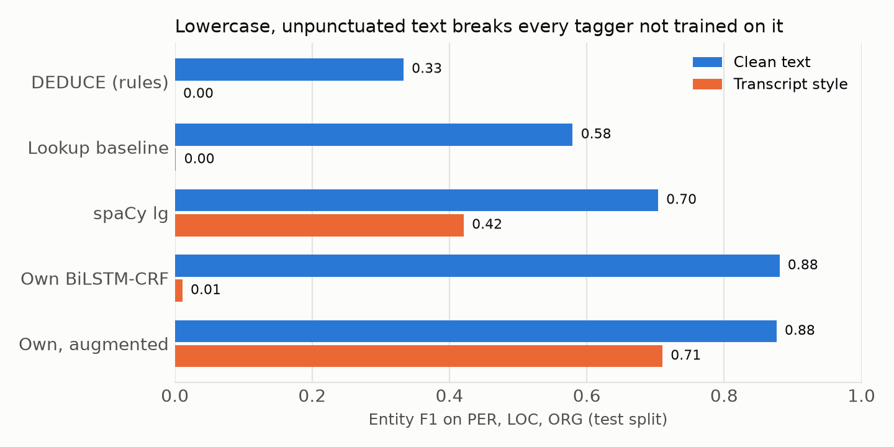
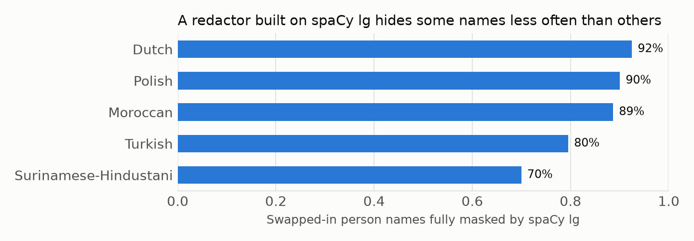

# 🏷️ ner_nl: how far does a Dutch tagger travel?

Named-entity recognition is the quiet first step of search, redaction and knowledge graphs. This
study asks three things about Dutch taggers: what happens away from the home corpus, what happens
when text looks like a speech transcript, and whose names get lost.

All numbers: test split of CoNLL-2002 Dutch (119 articles), commit `000e588`, 6 Nov 2026, 95%
bootstrap intervals over articles. Full tables in [`results/ner_nl/report.md`](../results/ner_nl/report.md),
hypotheses and verdicts in the [evaluation card](EVALUATION_CARD.md).

## Findings



| System (PER, LOC, ORG, exact match) | Clean F1 | Transcript-style F1 |
| --- | --- | --- |
| DEDUCE, rules for medical text | 0.333 (0.296 to 0.369) | 0.000 |
| Lookup baseline | 0.579 (0.543 to 0.615) | 0.001 (0.000 to 0.004) |
| spaCy `nl_core_news_sm` | 0.557 (0.517 to 0.594) | 0.265 (0.224 to 0.307) |
| spaCy `nl_core_news_md` | 0.672 (0.641 to 0.702) | 0.404 (0.359 to 0.446) |
| spaCy `nl_core_news_lg` | 0.704 (0.674 to 0.733) | 0.421 (0.378 to 0.465) |
| Own BiLSTM-CRF | 0.881 (0.861 to 0.902) | 0.011 (0.002 to 0.022) |
| Own, trained on half transcript-style text | 0.876 (0.854 to 0.898) | 0.710 (0.657 to 0.755) |

**A high score can hide a single point of failure.** The plain BiLSTM-CRF is the best system on
clean text and nearly useless without capital letters: it has learned that a name is a capitalised
word. Augmentation fixed that at no measurable cost on clean text (difference 0.000 on all labels,
-0.009 to 0.008). Without this test nobody would have known.

**The home advantage is large and easy to misread.** Own beats `lg` by 17.7 points (14.1 to 21.7),
but it trained on this very corpus and `lg` didn't. That measures fit to one annotation scheme, not
which tagger is better for Dutch. For reference, the LSTM-CRF of
[Lample et al.](https://arxiv.org/abs/1603.01360) reports 81.74 on all labels; the best-dev seed
here gets 0.858 (0.837 to 0.880) with seeds at 0.835, 0.858 and 0.857. The seed spread is about
half the interval width, so one lucky seed is not a result.

**Names are not treated alike.** Every gold person mention was replaced with a name from one of
five hand-written lists, same sentences, five random repeats:



| Exact PER recall | Dutch | Polish | Moroccan | Turkish | Surinamese-Hindustani |
| --- | --- | --- | --- | --- | --- |
| spaCy `lg` | 0.871 | 0.772 | 0.762 | 0.573 | 0.463 |
| Own BiLSTM-CRF | 0.974 | 0.960 | 0.948 | 0.939 | 0.886 |
| Own, augmented | 0.975 | 0.969 | 0.965 | 0.969 | 0.934 |
| DEDUCE | 0.885 | 0.485 | 0.737 | 0.764 | 0.791 |

The `lg` gap against the Dutch list is 40.8 points for the Surinamese-Hindustani list (35.8 to
45.0) and 29.8 for Turkish (26.1 to 33.5). A logistic mixed model in R, with article and surname as
random effects, keeps those two: odds ratios 0.08 (0.04 to 0.14) and 0.14 (0.08 to 0.25). For `md`
the same model drops the Polish gap that the bootstrap had called clear, which is why the name has
to be a random effect: the lists are a small sample of names, and the bootstrap ignores that.

The damage is mostly mislabelling, so a redactor suffers less than the recall suggests, but it
still suffers: `lg` fully masks 92% of swapped-in Dutch-list names and 70% of the Hindustani list
(post hoc analysis, not pre-registered). Those lost names get called ORG or GPE, or nothing.
The redaction study in [`pii_nl`](../pii_nl/) follows this up.

**Confidence needs recalibrating, and doesn't travel.** Temperature scaling on dev cut the span
calibration error from 0.040 to 0.017 for the own model (0.046 to 0.009 augmented). A threshold
chosen on clean dev data for 95% precision gave 94.6% on clean test for the augmented model, but 90.7% on transcript-style
test: a threshold is only valid for the kind of text it was fitted on.

**The gold labels hold up.** In 100 spans where `lg` and the own model agreed against gold, 75 were
model errors, 23 defensible either way and 2 true annotation errors. The hypothesised floor of 25
was met only exactly, and 8 of those 25 are one string. The honest reading: this corpus has few
errors that two good models can find.

## What this is not

- One Belgian newspaper in 2000. Nothing here covers Dutch from the Netherlands, legal text or chat.
- Transcript style is lowercase with punctuation removed, not real speech-to-text output, which
  also has word errors. Expect real pipelines to do worse.
- Name lists are short, hand-written and labelled by naming tradition. The swap ignores gender and
  context, and the Dutch-list recall beats recall on the original names (`lg` 0.756, own 0.931), so
  swapped sentences are easier than real text. Compare gaps, not levels.
- The R model is a fast approximation (`nAGQ = 0`) and treats repeats as independent, so its
  intervals are if anything too narrow.
- The label review was done by Claude, not by an annotator, and knowing the hypothesis.

## Run it

Everything comes from conda-forge, on CPU, about two hours on two cores:

```bash
micromamba create -n forge-ner -f ner_nl/environment.yml && micromamba activate forge-ner
chmod -R go-w "$CONDA_PREFIX/lib/nltk_data" && pip install "deduce>=3"
bash scripts/ner_study.sh
```

`ner_nl.redact` is a small local redactor (patterns with IBAN and BSN checks, plus a spaCy
pipeline), which `pii_nl` builds on and evaluates.

## Licences

CoNLL-2002 is limited to research use around the shared task and excludes commercial use, so no
sentence is in this repository, review verdicts are stored as positions only, and models trained
on it stay on your machine. spaCy's Dutch pipelines are CC BY-SA 4.0 by their own metadata, even
though the conda-forge index says MIT. DEDUCE is LGPL-3.0. It pins an old `regex`, which clashes
with current `transformers`, so give this study its own environment.
