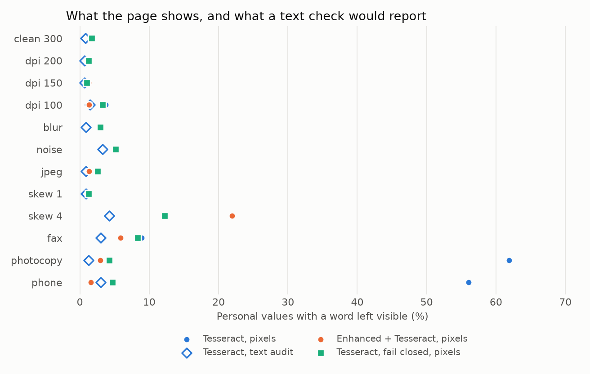

# 🖼️ scan_nl: what a text check can't see

Redaction tests usually compare text. But a scanned page is pixels first, and whatever the OCR never
read can't show up in a text check. So this project typesets generated Dutch documents, damages the
pages, runs OCR and a redactor, and then audits the black boxes against the **true ink position of
every personal value**.



## Findings

Blind templates, 120 documents, 12 damage conditions, 2026-11-06, commit ffe2dae. Intervals are
95% over templates. Synthetic pages only, so read the [card](EVALUATION_CARD.md) before quoting.

| Reader | Leak, `photocopy` | Leak, `phone` | Leak, all conditions | Ordinary words masked |
| --- | --- | --- | --- | --- |
| Perfect reading | 0.4% | 0.4% | 0.4% (0.0 to 0.9) | 7.8% |
| Tesseract | 61.9% (53.1 to 70.7) | 56.1% (48.1 to 64.1) | 14.1% (12.7 to 15.4) | 7.6% |
| Tesseract, text audit of the same pages | 1.2% | 3.0% | not pooled | |
| Tesseract + 15 lines of OpenCV | 2.9% (1.9 to 4.0) | 1.6% (0.8 to 2.3) | 4.1% (3.3 to 4.8) | 8.2% |
| Tesseract, black out what it didn't read | 4.3% | 4.7% | 4.1% (3.2 to 4.9) | 18.5% |
| RapidOCR 1.4.4 (PP-OCRv4 mobile) | 30.0% | 30.9% | 27.6% (23.9 to 31.3) | 16.5% |

1. **A text audit would have passed the worst pages.** Under a soft page shadow Tesseract's global
   threshold loses half the sheet. The output text looks clean, because the leaked words were never
   in it.
2. **Confidence is the wrong alarm.** Mean OCR confidence stays high on half-read pages. Counting ink
   that no word explains catches 78% of leaked values on 20% of the pages, where the same number of
   lowest-confidence pages catches 44%.
3. **Cheap fixes beat clever ones.** Flattening the background cuts the hard-pool leak by 91%.
   Character-confusion repair and digit masking did almost nothing, at a real cost.
4. **Fail closed works, and costs the page.** On a shadowed page it blacks out most of the text. A
   person should look at those pages anyway.

Three of ten hypotheses were wrong, in whole or part, and stay in the card.

## Run it

Needs `tesseract-ocr`, `tesseract-ocr-nld`, Liberation and Carlito fonts.

```bash
pip install -e ".[pii,scan]"
python -m scan_nl.run ocr --split blind      # about 90 minutes on 2 cores, cached
python -m scan_nl.run score --split blind    # about 90 minutes, needs nl_core_news_lg
python -m scan_nl.run report --split blind
python -m scan_nl.hypotheses --split blind
```

Black out a single page, locally:

```bash
python -m scan_nl.cli page.png -o page_redacted.png   # exit code 3 means: have a person look
docker build -f scan_nl/Dockerfile -t scan-nl .       # never built yet
python -m scan_nl.app                                 # Gradio demo for fictional pages, untested
```

The CLI and demo use `tesseract_enh` plus `unread`, the combination chosen after the blind run. It
has no blind result of its own, and it does not deskew.
