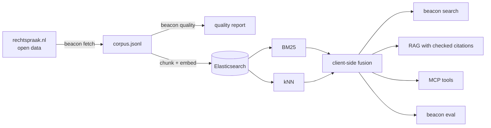

# 🔦 Beacon

Hybrid search and RAG over Dutch documents, on a single-node Elasticsearch that runs on a
laptop. It comes with an honest evaluation harness and an MCP server, so an agent can search
the collection too.



## Try it in a minute

No Docker and no model download. This uses a synthetic corpus and the in-process backend.

```bash
python -m venv .venv && source .venv/bin/activate
pip install -e ".[dev]"
pytest
make demo
```

## The real stack

```bash
cp .env.example .env              # then change every password
docker compose up -d elasticsearch
# With Kibana on http://localhost:5601 (user elastic):
# docker compose --profile kibana up -d

pip install -e ".[dev,embed]"     # adds sentence-transformers and torch

# One month of decisions. Sequential and rate-limited; 500 documents takes a few minutes.
beacon fetch --date-from 2024-01-01 --date-to 2024-01-31 --max-docs 500
beacon quality --corpus data/corpus.jsonl --out reports/quality.md
beacon ingest --corpus data/corpus.jsonl --recreate

beacon search "ontslag op staande voet wegens diefstal" --subject Arbeidsrecht
beacon ask "Wanneer is een ontslag op staande voet geldig?"
```

Security is on, ports bind to `127.0.0.1` only, and passwords come from `.env`. HTTP TLS is
off because traffic stays on loopback; turn it on before you expose the stack anywhere else.

## Design decisions

- **Fusion runs in the client.** Elasticsearch's native `rrf` and `linear` retrievers need an
  Enterprise licence and return a 403 on Basic. Beacon sends plain BM25 and plain kNN, then fuses
  the results itself. A test asserts that no request needs a paid feature.
- **Pluggable embedders.** `st:intfloat/multilingual-e5-small` is the default. It needs its
  `query:` and `passage:` prefixes, which are applied for you and covered by a test.
  `spacy:nl_core_news_md` is a light Dutch baseline, and `hash` is for offline tests.
- **`int8_hnsw` is explicit.** The server default for 384 dimensions and up is BBQ quantisation,
  and pinning it keeps results comparable between versions.
- **Results are per document.** Chunks are ranked, then collapsed, so one long ruling cannot fill
  the list. An ECLI in a query is resolved by exact lookup.
- **Retrieved text is untrusted.** The XML parser refuses entities and network access. Prompts
  mark passages as data. Every citation is checked after generation, and MCP results label
  document text as `untrusted_text`. This limits prompt injection through documents, but does not
  rule it out.
- **Data minimisation.** The parser skips contributor metadata and the `uitspraak.info` header,
  where names of judges and lawyers appear. Downloads land in the git-ignored `data/` folder.

## Measuring quality

```bash
beacon eval --demo --embedder spacy --baseline dense --out reports/my-run.md
beacon eval-rag --demo --embedder spacy

# Real data, no hand labels: a decision's summary should find that decision.
beacon ingest --corpus data/corpus.jsonl --recreate --no-summaries
beacon eval --known-item --corpus data/corpus.jsonl --limit 300 --out reports/known-item.md

# Real data, hand labels: one JSON object per line.
# {"id":"q1","kind":"paraphrase","query":"...","relevant":{"ECLI:...":2,"ECLI:...":1}}
beacon eval --queries eval/my-queries.jsonl --corpus data/corpus.jsonl
```

The harness reports recall@k, nDCG@k and MRR at document level, with 95% bootstrap intervals.
Comparisons use a paired sign-flip test with Holm correction. Linear fusion's weight is tuned by
cross-validation, so it is never scored on the queries that tuned it.

### What the demo run shows

These figures come from [`reports/`](reports/). The corpus is **synthetic, tiny and written by
the same author as the queries**, so they test the pipeline. They are not an estimate of real
quality. The default e5 model has not been evaluated yet.

nDCG@10 on 30 queries (12 lexical, 18 paraphrase), with Dutch word vectors, in-process backend:

| Run | All | Lexical | Paraphrase | recall@10 |
| --- | --- | --- | --- | --- |
| BM25 | 0.613 | 1.000 | 0.355 | 0.667 |
| Dense | 0.816 | 1.000 | 0.694 | 0.933 |
| RRF | 0.781 | 1.000 | 0.635 | 0.967 |
| Linear (cv) | 0.796 | 1.000 | 0.660 | 0.933 |

What I take from it:

- **Hybrid did not beat dense on ranking here.** RRF minus dense is -0.035 (95% CI -0.116 to
  +0.046, p = 0.42), so there is no evidence either way at this sample size. RRF did find the most
  documents at depth 10. "Hybrid is always better" is not what these data show.
- **The lexical queries are too easy.** Every method scores 1.000 on them, because I wrote them
  next to the documents. They cannot separate methods.
- **Leakage is dramatic.** Known-item evaluation with summaries left in the index scores a perfect
  1.000 for every method. With them removed, BM25 falls to 0.854 and dense to 0.821.
- **Engines differ.** BM25 on paraphrases scores 0.355 with the local stemmer and 0.307 with Lucene's
  Dutch analyzer (hash embedder runs), so numbers from the local backend do not carry over.
- **The extractive generator is cautious to a fault.** It abstained on all 4 unanswerable questions,
  and it had no invalid citations, but it also answered only 12 of 30 answerable ones while the right
  document was in context for 27. Paraphrases need a real LLM.

## Connect an agent

The server is read-only and has four tools: `search`, `get_document`, `ask` and `index_info`.

```bash
# Claude Code, against the real index
claude mcp add beacon -- beacon mcp --backend elastic

# Try it without any stack
claude mcp add beacon-demo -- beacon mcp --demo --embedder hash
```

## Status

| Part | State |
| --- | --- |
| Unit tests, lint | 104 passing, ruff clean |
| MCP server | Tested in memory and over real stdio |
| Elasticsearch backend | Integration tests pass against **OpenSearch 3.9 through a shim**, using the real Elasticsearch client. **Not yet run on Elasticsearch itself** |
| kNN on a live engine | **Not exercised**: the shim scored vectors itself, so HNSW and `int8_hnsw` are untested |
| rechtspraak.nl client | Built from the published spec and tested with synthetic XML. **Never run against the live service** |
| Docker Compose | `docker compose config` passes. **Containers never started** |
| Default e5 embedder | Prefix logic tested with a fake model. **Real model never loaded** |

See [`../PROGRESS.md`](../PROGRESS.md) for the next steps, and
[`PRIVATE_SEARCH_TEMPLATE.md`](PRIVATE_SEARCH_TEMPLATE.md) for reuse on other documents.

## Limitations

- This is a demo of search, not legal advice, and it can miss relevant decisions.
- Only a selection of Dutch rulings is published, so search here is not a complete view of case law.
- Pseudonymisation is done by the courts and can be imperfect. Do not try to re-identify anyone, and
  do not republish downloaded text without checking it. `beacon quality` flags identifier-shaped
  strings, but a clean report does not prove that a text holds no personal data.
- Dutch compounds are a known weak spot for BM25: `woninginbraak` does not match `inbraak`.
- `multilingual-e5-small` is listed as MIT on a third-party page. Confirm on the
  model card before commercial use. The spaCy Dutch model is CC BY-SA 4.0.
