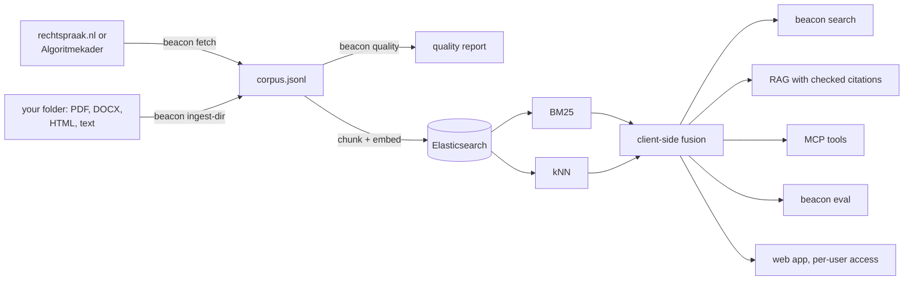

# 🔦 Beacon

Hybrid search and RAG over Dutch documents, on a single-node Elasticsearch that runs on a
laptop. It comes with an honest evaluation harness and an MCP server, so an agent can search
the collection too.

It has been tested on real Dutch government text, with relevance labels the author did not
write. See [Results on real text](#results-on-real-text).



## Try it in a minute

No Docker and no model download. This uses a synthetic corpus and the in-process backend.

```bash
python -m venv .venv && source .venv/bin/activate
pip install -e ".[dev]"
pytest
make demo
```

## Search your own folder

Reads PDF, Word, HTML and text files, tells you what it could not read, and serves a small web app
with per-user access. Details are in [`PRIVATE_SEARCH_TEMPLATE.md`](PRIVATE_SEARCH_TEMPLATE.md).

```bash
pip install -e ".[web,onnx,files,compounds]" && beacon fetch-model
beacon ingest-dir ~/documenten --acl acl.yaml --out data/files/corpus.jsonl
beacon add-user lena --groups juridisch,iedereen
beacon serve --backend local --corpus data/files/corpus.jsonl \
  --embedder onnx:data/models/multilingual-e5-small
```

## The real stack

```bash
cp .env.example .env              # then change every password
docker compose up -d elasticsearch
# With Kibana on http://localhost:5601 (user elastic):
# docker compose --profile kibana up -d

pip install -e ".[dev,embed]"     # adds sentence-transformers and torch

# One month of decisions. Sequential and rate-limited; 500 documents takes a few minutes.
beacon fetch --date-from 2024-01-01 --date-to 2024-01-31 --max-docs 500
beacon quality --corpus data/corpus.jsonl --out reports/quality.md
beacon ingest --corpus data/corpus.jsonl --recreate

beacon search "ontslag op staande voet wegens diefstal" --subject Arbeidsrecht
beacon ask "Wanneer is een ontslag op staande voet geldig?"
```

Security is on, ports bind to `127.0.0.1` only, and passwords come from `.env`. HTTP TLS is
off because traffic stays on loopback; turn it on before you expose the stack anywhere else.

## Design decisions

- **`smart` is the default mode.** RRF that skips BM25 for non-Dutch queries, adds known synonyms and
  matches exact statute citations. It was [scored once on fresh queries](reports/ak-routing.md).
- **Fusion runs in the client.** Elasticsearch's native `rrf` and `linear` retrievers need an
  Enterprise licence and return a 403 on Basic. Beacon sends plain BM25 and plain kNN, then fuses
  the results itself. A test asserts that no request needs a paid feature.
- **Pluggable embedders.** `st:intfloat/multilingual-e5-small` is the default. It needs its
  `query:` and `passage:` prefixes, which are applied for you and covered by a test.
  `spacy:nl_core_news_md` is a light Dutch baseline, and `hash` is for offline tests.
- **`int8_hnsw` is explicit.** The server default for 384 dimensions and up is BBQ quantisation,
  and pinning it keeps results comparable between versions.
- **Results are per document.** Chunks are ranked, then collapsed, so one long ruling cannot fill
  the list. An ECLI in a query is resolved by exact lookup.
- **Retrieved text is untrusted.** The XML parser refuses entities and network access. Prompts
  mark passages as data. Every citation is checked after generation, and MCP results label
  document text as `untrusted_text`. This limits prompt injection through documents, but does not
  rule it out.
- **Data minimisation.** The parser skips contributor metadata and the `uitspraak.info` header,
  where names of judges and lawyers appear. Downloads land in the git-ignored `data/` folder.

## Measuring quality

```bash
beacon eval --demo --embedder spacy --baseline dense --out reports/my-run.md
beacon eval-rag --demo --embedder spacy

# Real data, no hand labels: a decision's summary should find that decision.
beacon ingest --corpus data/corpus.jsonl --recreate --no-summaries
beacon eval --known-item --corpus data/corpus.jsonl --limit 300 --out reports/known-item.md

# Real data, hand labels: one JSON object per line.
# {"id":"q1","kind":"paraphrase","query":"...","relevant":{"ECLI:...":2,"ECLI:...":1}}
beacon eval --queries eval/my-queries.jsonl --corpus data/corpus.jsonl
```

The harness reports recall@k, nDCG@k and MRR at document level, with 95% bootstrap intervals.
Comparisons use a paired sign-flip test with Holm correction. Linear fusion's weight is tuned by
cross-validation, so it is never scored on the queries that tuned it.

### What the demo run shows

These figures come from [`reports/`](reports/). The corpus is **synthetic, tiny and written by
the same author as the queries**, so they test the pipeline. They are not an estimate of real
quality. The default e5 model has not been evaluated yet.

nDCG@10 on 30 queries (12 lexical, 18 paraphrase), with Dutch word vectors, in-process backend:

| Run | All | Lexical | Paraphrase | recall@10 |
| --- | --- | --- | --- | --- |
| BM25 | 0.613 | 1.000 | 0.355 | 0.667 |
| Dense | 0.816 | 1.000 | 0.694 | 0.933 |
| RRF | 0.781 | 1.000 | 0.635 | 0.967 |
| Linear (cv) | 0.796 | 1.000 | 0.660 | 0.933 |

What I take from it:

- **Hybrid did not beat dense on ranking here.** RRF minus dense is -0.035 (95% CI -0.116 to
  +0.046, p = 0.42), so there is no evidence either way at this sample size. RRF did find the most
  documents at depth 10. "Hybrid is always better" is not what these data show.
- **The lexical queries are too easy.** Every method scores 1.000 on them, because I wrote them
  next to the documents. They cannot separate methods.
- **Leakage is dramatic.** Known-item evaluation with summaries left in the index scores a perfect
  1.000 for every method. With them removed, BM25 falls to 0.854 and dense to 0.821.
- **Engines differ.** BM25 on paraphrases scores 0.355 with the local stemmer and 0.307 with Lucene's
  Dutch analyzer (hash embedder runs), so numbers from the local backend do not carry over.
- **The extractive generator is cautious to a fault.** It abstained on all 4 unanswerable questions,
  and it had no invalid citations, but it also answered only 12 of 30 answerable ones while the right
  document was in context for 27. Paraphrases need a real LLM.

## Connect an agent

The server is read-only and has four tools: `search`, `get_document`, `ask` and `index_info`.
Over stdio it serves the groups it was started with. `beacon serve` also offers it at `/mcp/`, where
each user's bearer token decides what they can reach, and every tool call goes in the audit log.

```bash
# Claude Code, against the real index
claude mcp add beacon -- beacon mcp --backend elastic

# Try it without any stack
claude mcp add beacon-demo -- beacon mcp --demo --embedder hash
```

## Results on real text

The test corpus is the [Algoritmekader](https://github.com/MinBZK/Algoritmekader) (EUPL-1.2),
Dutch government guidance on algorithms and AI: 198 pages, 65,000 words, pinned to one commit.
It suits evaluation because of two sets of labels the author had no part in:

- **Audit task, 139 queries.** Norms from the Auditdienst Rijk and the Algemene Rekenkamer, each
  mapped to the measures that cover it by the people behind the Algoritmekader.
- **Requirement task, 60 queries.** Legal requirements, mapped to measures in page metadata.

The plan was [committed before the first run](evals/PREREGISTRATION.md): tune on one half, freeze,
score the other half once. All of this used the quantised `multilingual-e5-small` on CPU and the
in-process backend.

```bash
make real-data                        # corpus, labels and model, no Docker and no torch
python evals/experiment.py dev        # 3 minutes on a 2-core laptop
```

### Holdout: 99 queries, scored once ([report](reports/ak-holdout.md))

| Run | nDCG@10 | 95% interval | recall@10 |
| --- | --- | --- | --- |
| BM25 | 0.508 | 0.44 to 0.58 | 0.596 |
| Dense | 0.509 | 0.43 to 0.59 | 0.553 |
| Hybrid RRF | 0.545 | 0.47 to 0.62 | 0.643 |
| Hybrid, tuned on dev | **0.595** | 0.53 to 0.66 | 0.681 |

| Comparison, from the plan | nDCG@10 difference | p (Holm) | Expected? |
| --- | --- | --- | --- |
| Hybrid vs BM25 | +0.037 | 0.209 | Direction yes, not significant |
| Hybrid vs dense | +0.036 | 0.209 | Direction yes, not significant |
| Tuned vs hybrid | +0.050 | 0.005 | Yes |

What this says:

- **Plain hybrid did not clearly beat either part** on this set, in line with the demo result.
- **Most of the tuning gain comes from one line.** Repeating the page title in each chunk gave
  +0.047 on its own ([exploratory breakdown](reports/ak-ablation.md)). It costs nothing.
- **The requirement task is hard for everything**, at about 0.24. Those labels are broad (up to
  35 measures per requirement) and probably incomplete, so the absolute number says little.
- **Compound splitting did not earn its place.** The dev gain that kept it in the config came
  from a bug: words were "split" into their own singular form. After the fix it adds about
  nothing to hybrid on dev. The holdout table above was scored before the fix and is left as it
  was. On Lucene, a common-word list raised BM25 from 0.545 to 0.566 on dev, not significantly
  (p = 0.30). See the [Lucene check](reports/ak-lucene-check.md).

### Short queries: 41 hand-written ([report](reports/ak-hand-queries.md))

Formal audit language suits BM25, so a second set uses short queries, 10 of them in English. These
were written before seeing any ranking, then labelled from a blind pool by one AI annotator. That
is the weakest evidence here, and a person should re-judge a sample.

| Type | n | BM25 | Dense | Hybrid | Tuned |
| --- | --- | --- | --- | --- | --- |
| English queries on Dutch text | 10 | 0.425 | **0.882** | 0.707 | 0.737 |
| Dutch paraphrases | 5 | 0.281 | **0.574** | 0.496 | 0.433 |
| Dutch questions | 10 | 0.551 | 0.523 | 0.559 | **0.651** |
| Dutch short queries | 12 | 0.618 | 0.736 | 0.700 | **0.770** |
| Citing a statute | 4 | 0.493 | **0.643** | 0.580 | 0.631 |

Dense search beats BM25 clearly here (+0.190, p = 0.001), the reverse of what long formal text
suggests. Which method is best depends on the queries, so label the ones your users will type.
Fusion hurts English queries, because BM25 only adds noise there. Routing by query language looks
like the obvious next step, and it needs new test queries.

Statute lookup has a known gap: page reference lists are dropped, as they could leak labels, so
no run found `artikel 14 AI-verordening`.

### Prompt injection ([report](reports/ak-injection.md))

Harmless canary instructions were planted in 12 documents, with the document's own title as the
query, which is the best case for an attacker. There are 21 payloads, tried plain and with the
title stuffed around them.

| Payloads | Detected by rules | Reached the top 5 | Reached the top 5, guard on |
| --- | --- | --- | --- |
| 9 used to write the rules | 9 of 9 | 54% when stuffed | 0% |
| 12 written after freezing them | **0 of 12** | 53% when stuffed | **53%** |

The rules flagged 0 of 1,133 clean passages, and they also missed every payload they had not seen.
Treat rule-based filtering as a speed bump. Three more limits apply: a plain payload at the end
of a page reached 0% only because results collapse to one passage per document, so `get_document`
still returns it in full. The extractive generator never leaked a canary, which says nothing about
an LLM. And one author wrote both rules and payloads. Security here rests on read-only tools,
least privilege and access control, not on detection.

## Access control

Each document has `acl` groups, and `public` is the default. Start a process with `--groups` or
`BEACON_GROUPS`, and every path is limited to those groups: lexical, dense, exact lookup,
`get_document` and RAG. A forbidden document looks the same as a missing one. Groups are set by
whoever starts the server, and no MCP tool takes them as an argument. Without a setting there is no
filtering, which suits a trusted operator on a command line.

```bash
beacon mcp --backend elastic --groups public,legal
```

Four deliberate faults in the scoping code were each caught by `tests/test_acl.py`.

## Status

| Part | State |
| --- | --- |
| Unit tests, lint | 158 passing, ruff clean |
| Real Dutch data | Algoritmekader fetched live and parsed, labels joined, rebuild reproduced |
| Real e5 model | Quantised ONNX runs on CPU. It comes from a third-party npm package, so check its hash |
| MCP server | Tested in memory and over real stdio on the real corpus (`evals/mcp_smoke.py`) |
| Elasticsearch backend | 10 integration tests pass against **OpenSearch 3.9 through a [shim](tests/tools/opensearch_shim.py)**, with the real client. **Not yet run on Elasticsearch itself** |
| Dutch analyzer, compound filter, ACL filter | Run on Lucene 10.5 through OpenSearch |
| kNN on a live engine | **Not exercised**: the shim scores vectors itself, so HNSW and `int8_hnsw` are untested |
| rechtspraak.nl client | Built from the published spec and tested with synthetic XML. **Never run against the live service** |
| Docker Compose | `docker compose config` passes. **Containers never started** |
| Local LLM answers | **Not run.** Only the extractive generator has real results |

See [`../PROGRESS.md`](../PROGRESS.md) for the next steps, and
[`PRIVATE_SEARCH_TEMPLATE.md`](PRIVATE_SEARCH_TEMPLATE.md) for reuse on other documents.

## Limitations

- This is a demo of search, not legal advice, and it can miss relevant decisions.
- Only a selection of Dutch rulings is published, so search here is not a complete view of case law.
- Pseudonymisation is done by the courts and can be imperfect. Do not try to re-identify anyone, and
  do not republish downloaded text without checking it. `beacon quality` flags identifier-shaped
  strings, but a clean report does not prove that a text holds no personal data.
- Dutch compounds are a weak spot for BM25: `woninginbraak` does not match `inbraak`. The splitter
  helps some queries and adds noise to others, so measure it on your own data.
- The Algoritmekader results cover one small, tidy corpus. Expect different numbers elsewhere.
- `multilingual-e5-small` is listed as MIT on a third-party page. Confirm on the
  model card before commercial use. The spaCy Dutch model is CC BY-SA 4.0.

### Fresh queries: routing, scored once ([report](reports/ak-routing.md))

The [plan](evals/PREREGISTRATION-3.md) was committed before any fresh query was ranked. 62 new
queries, labelled blind by two AI annotators (weighted kappa 0.485, so moderate at best).

| Planned test | n | Result |
| --- | --- | --- |
| Skipping BM25 for non-Dutch queries | 29 | **0.548 to 0.793** (+0.245, Holm p under 0.001) |
| The same router on Dutch queries | 23 | No query changed |
| Synonyms on abbreviation queries | 10 | +0.003, not supported. The second annotator's labels give +0.035 |
| Exact citations on statute lookups | 128 | +0.149, but partly circular, see the report |

Plain dense search scored 0.789 overall, level with the full `smart` pipeline at 0.781 and above RRF
at 0.656. This was not a planned comparison, but it is another reminder that hybrid is not
automatically better. Hybrid kept a small lead on recall@10 (0.854 against 0.828).

### Checking claims without an LLM ([report](reports/ak-groundedness.md))

`ask` checks each claim against the passage it cites. On 45 unseen passages, with claims written by
a separate AI agent that never saw the checker, it flagged every wrong citation, 87% of hallucinated
details and 58% of subtle errors. It raised false alarms on 12% of correct claims. A clean result
proves nothing, and no real LLM has been run through it yet.
