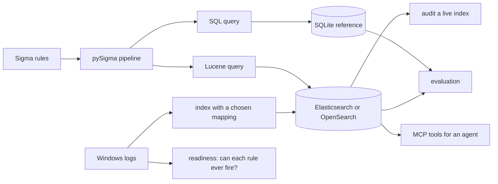

# 🌙 Nightwatch

Do your detection rules work on the logs you actually have? Nightwatch runs Sigma rules through an
Elasticsearch-style index and measures what fires, what stays silently blind, and why.

The headline, from 380 rules tested on their own samples: **with a default dynamic mapping only 20%
fire. With the right mapping and two small fixes, 98% do. No setup reported an error for the
difference.** See [Results](#results).



## Try it

No engine needed for most of this.

```bash
python -m venv .venv && source .venv/bin/activate
pip install -e ".[dev]"
pytest
nightwatch fetch                                  # rules and logs, pinned, about 600 MB
nightwatch readiness                              # which rules can fire on these logs
nightwatch convert path/to/rule.yml --to esql     # also: tuned, lucene, eql
python evals/mcp_smoke.py                         # read-only hunting tools, in-process store
```

## With an engine

```bash
cp .env.example .env               # then change every password
docker compose up -d elasticsearch # add --profile kibana for Kibana on 127.0.0.1:5601
set -a; source .env; set +a

nightwatch index --variant tuned               # 750,000 lab events
nightwatch audit --index nightwatch-logs       # read-only check of mapping and rule readiness
claude mcp add nightwatch -- nightwatch mcp --index nightwatch-logs

NIGHTWATCH_IT=1 pytest -m integration
```

`nightwatch audit` works on any index that keeps Windows field names, and changes nothing. It is
the useful part if you already run a cluster.

## Results

Numbers are from **OpenSearch 3.9 on Lucene 10.5**, since Elasticsearch could not be downloaded
where this ran. Both use Lucene, but [nothing here is a measurement of Elasticsearch](#status).
Plan [committed first](evals/PREREGISTRATION.md), test split scored once.

### Mapping decides whether a rule fires ([report](reports/regression.md))

| Index setup | Rules firing on their own sample, of 380 |
| --- | --- |
| Default dynamic mapping | **75 (20%)** |
| `keyword`, raw | 294 (77%) |
| `keyword`, lowercase normalizer | 354 (93%) |
| Plus long values stored as overlapping pieces | 365 (96%) |
| Plus regex and CIDR rewrites (`tuned`) | **372 (98%)** |
| SQLite, as a reference | 375 (99%) |

Each silent failure has a plain cause:

| What goes wrong | Effect |
| --- | --- |
| A wildcard meets analysed text | `*\cmd.exe` is compared with single tokens, and matches nothing |
| A rule is case-insensitive, a keyword field is not | `CMD.EXE` does not match `cmd.exe` |
| A value passes `ignore_above` | Stored and not searchable. 26% of the PowerShell script blocks in these logs are over 8,191 characters |
| Lucene regexes match the whole term | An unanchored Sigma regex matches almost nothing |
| A CIDR on a keyword field | A literal string. Under `NOT`, the filter silently stops filtering |

### What fires on labelled attack logs ([report](reports/detection.md))

78 lab datasets, 560,704 events, 2,412 rules, `tuned` setup.

| Measure | Result |
| --- | --- |
| Datasets with any alert | 77 of 78 |
| Datasets with an alert on the right technique | **53 of 78, 68%** |
| Same, with only rules dated before the dataset | **33 of 78, 42%** (p under 0.001) |
| Rules that fired | 214 of 2,412 |
| High or critical rules more often on target than low or medium? | 30% against 22%, **not significant** (p = 0.082, and an R mixed model agrees) |

- **Any-alert coverage is close to meaningless.** A logoff event rule fired on 55 datasets.
- **Testing new rules on old public logs flatters them.** The date filter costs 26 points of recall.
- **A default mapping fails both ways.** The same run gave 33 of 78 on target and seventy times as
  many hits. There is no benign baseline here, so an off-target alert is not a proven false positive.

## Recommended index setup

```json
{
  "settings": {"analysis": {"normalizer": {"lower": {"type": "custom", "filter": ["lowercase"]}}}},
  "mappings": {"dynamic_templates": [{"strings": {
    "match_mapping_type": "string",
    "mapping": {"type": "keyword", "normalizer": "lower", "ignore_above": 8191}
  }}]}
}
```

Add `chunk_long_values` at ingest, and use `lucene_tuned` from `convert()` for queries. `nightwatch
index --variant tuned` does both. Measure it on your own engine before trusting it.

## Agents and logs

`nightwatch mcp` offers five read-only tools: `coverage`, `find_rules`, `explain_rule`, `run_rule`
and `search_logs`. The zero problem shapes the design: `run_rule` returns readiness next to the
alert count, so an agent can tell "nothing happened" from "this rule cannot see".

A command line is text an attacker wrote. Log content is returned as `untrusted_log_text`, and the
server tells the agent not to follow it. That is a label and no guarantee, as the
[injection results in Beacon](../beacon/README.md#prompt-injection-report) show.

## Design decisions

- **Plain REST, no vendor client.** Only calls shared by both engines, so a client product check
  cannot get in the way, and the first Elasticsearch run needs only a URL.
- **`QueryFailed` is never a zero.** A refused query raises, and is reported apart from no hits.
- **`query_string` only.** It needs no paid licence. ES|QL and EQL can be printed, not yet run.
- **Native Windows field names.** Rules and logs both use them. ECS names need a mapping pipeline,
  and pySigma has one, but it would add another thing to measure.
- **All values are strings**, so `EventID: 1` behaves the same on every engine.

## Status

| Part | State |
| --- | --- |
| Tests, lint | 55 unit and 5 integration tests pass, ruff clean |
| Lucene behaviour | Measured on OpenSearch 3.9, Lucene 10.5 |
| **Elasticsearch** | **Never run.** Downloads were blocked. `ci/nightwatch-ci.yml` closes this |
| Docker Compose | Adapted from Beacon's. **Containers never started** |
| ES\|QL and EQL | Conversion prints a query. Never executed |
| Kibana | Nothing built yet |
| MCP | Real stdio on the attack corpus, against both the engine and SQLite |
| R cross-check | `evals/mixed_model.R`, run on lme4 2.0.6 |

## Data and licences

Downloaded at run time and pinned; nothing is committed. Rules are from
[SigmaHQ](https://github.com/SigmaHQ/sigma) under the
[Detection Rule License 1.1](https://github.com/SigmaHQ/Detection-Rule-License), which requires
keeping the rule's author on any message based on a match, so alerts in a product must show it.
Logs are from [Security-Datasets](https://github.com/OTRF/Security-Datasets) (MIT): simulated lab
activity with lab account names. Author names in dataset metadata are not kept.

See [`../PROGRESS.md`](../PROGRESS.md) for next steps.
